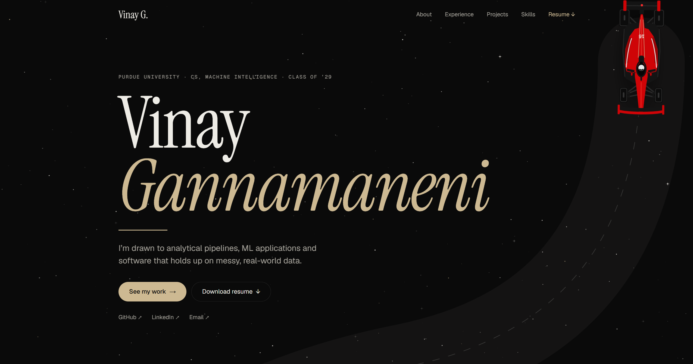

# Vinay Gannamaneni · Portfolio

My personal portfolio, built from scratch with Next.js and Supabase. Black and Purdue gold, a top-down F1 car that drives a circuit down the page as you scroll, and a private admin panel so every piece of content can be edited without touching code.

**Live site: [vinayg.dev](https://vinayg.dev)**



## Highlights

### Public site

- **Scroll-linked F1 car**: a red #16 car drives an S-shaped circuit from the top of the page to a checkered finish at the bottom. Its position is a pure function of scroll distance, precomputed into 600 keyframes and run as a CSS scroll-driven animation on the compositor thread, so it never lags behind or jitters, even on aggressive scrolling. Browsers without `ScrollTimeline` fall back to a lightweight `requestAnimationFrame` handler.
- **Layered road**: the track sits above the section panels but below the text, using stacking contexts (`isolation: isolate` plus z-index layers) rather than masking.
- **Twinkling starfield**: a canvas background with a slight scroll parallax, sized to screen area so it stays light on phones.
- **Flip-over project cards**: the front shows the date, title and description; hover (or tap on touch screens) to flip to the tech stack, screenshots and up to 3 custom-named links.
- **Experience timeline**: each role has a bar on a shared timeline axis. Hovering a row smoothly expands it in place to show every bullet, with hover intent so passing the cursor over doesn't trigger it.
- **Smooth in-page navigation** for every anchor link, and one-time reveal animations driven by a single `IntersectionObserver`.
- **Performance-minded motion**: all hover effects animate only `transform` and `opacity`, and everything respects `prefers-reduced-motion`.
- **Image lightbox**, a one-click resume download, and a responsive layout down to phone width.

### Admin panel (`/admin`)

- Email and password sign-in through Supabase Auth, visually separate from the public site so it's never mistaken for it
- Editors for profile, experience, projects, skills, education and certifications
- Drag-and-drop reordering (keyboard arrows work too)
- Photo, resume and screenshot uploads straight to Supabase Storage
- Per-project "Visible on site" switch, card-corner picker and up to 3 named links
- Live save status and a built-in setup check that shows the SQL to run if the database is missing a column

## Tech stack

| Layer | Technology |
| --- | --- |
| Framework | Next.js 16 (App Router), React 19, TypeScript |
| Styling | Hand-written CSS with design tokens, Tailwind CSS v4 |
| Fonts | Instrument Serif, Geist, Geist Mono via `next/font` |
| Animation | CSS scroll-driven animations (Web Animations API), Canvas 2D |
| Database | Supabase (PostgreSQL) with Row Level Security |
| Auth | Supabase Auth |
| Storage | Supabase Storage |
| Hosting | Vercel |

## Project structure

```
vinay-portfolio/
├── app/
│   ├── admin/
│   │   ├── login/page.tsx        # Admin sign-in
│   │   └── page.tsx              # Admin dashboard (all editors)
│   ├── components/
│   │   ├── RaceTrack.tsx         # Circuit and scroll-linked car
│   │   ├── f1Car.ts              # Car artwork (SVG)
│   │   ├── StarField.tsx         # Twinkling canvas background
│   │   ├── Navbar.tsx
│   │   ├── Hero.tsx
│   │   ├── Stats.tsx
│   │   ├── About.tsx
│   │   ├── Experience.tsx        # Timeline rows that expand on hover
│   │   ├── Projects.tsx          # Flip-over project cards
│   │   ├── Skills.tsx
│   │   ├── Certifications.tsx    # Education, certifications, leadership
│   │   ├── Footer.tsx
│   │   ├── Lightbox.tsx
│   │   └── RevealObserver.tsx    # Scroll reveal animations
│   ├── content.ts                # Static text not stored in the database
│   ├── globals.css               # Design tokens and all styles
│   ├── layout.tsx                # Root layout and fonts
│   └── page.tsx                  # Home page (data fetching)
├── lib/
│   ├── supabase.ts               # Supabase client
│   ├── types.ts                  # Shared data types
│   └── resume.ts                 # Resume download helper
├── .env.local                    # Environment variables (not committed)
└── package.json
```

## Running it locally

**Prerequisites:** Node.js 20+, a Supabase project, and a Vercel account if you want to deploy.

1. **Clone and install**

   ```bash
   git clone https://github.com/vgannama-cloud/vinay-portfolio.git
   cd vinay-portfolio
   npm install
   ```

2. **Add environment variables** in a `.env.local` file at the project root:

   ```
   NEXT_PUBLIC_SUPABASE_URL=your_supabase_url
   NEXT_PUBLIC_SUPABASE_ANON_KEY=your_supabase_anon_key
   ```

3. **Create the database.** In Supabase, open **SQL Editor**, paste this and run it:

   ```sql
   create table profile (
     id uuid primary key default gen_random_uuid(),
     name text, tagline text, subtitle text, about text,
     email text, github text, linkedin text, twitter text,
     skills text[] default '{}',
     photo_url text, resume_url text,
     stats jsonb
   );

   create table experiences (
     id uuid primary key default gen_random_uuid(),
     title text, company text, location text, duration text,
     description text[] default '{}',
     tags text[] default '{}',
     images text[] default '{}',
     sort_order int default 0
   );

   create table projects (
     id uuid primary key default gen_random_uuid(),
     title text, description text, category text, status text,
     tags text[] default '{}',
     link text, github text,
     links jsonb default '[]',
     images text[] default '{}',
     visible boolean default true,
     card_rank text, card_suit text,
     sort_order int default 0
   );

   create table skills (
     id uuid primary key default gen_random_uuid(),
     category text,
     skills text[] default '{}',
     sort_order int default 0
   );

   create table education (
     id uuid primary key default gen_random_uuid(),
     school text, degree text, details text, location text,
     date text, activities text,
     sort_order int default 0
   );

   create table certifications (
     id uuid primary key default gen_random_uuid(),
     title text, issuer text, description text,
     skills text[] default '{}',
     date text,
     sort_order int default 0
   );

   -- Anyone can read; only a signed-in user can change anything
   do $$
   declare t text;
   begin
     foreach t in array array['profile','experiences','projects','skills','education','certifications'] loop
       execute format('alter table %I enable row level security', t);
       execute format('create policy "public read" on %I for select using (true)', t);
       execute format('create policy "admin write" on %I for all to authenticated using (true) with check (true)', t);
     end loop;
   end $$;

   insert into profile (name) values ('Your Name');
   ```

   Then go to **Storage**, create a **public** bucket named `images`, and add a policy that lets authenticated users upload to it.

4. **Create your admin login.** In **Authentication → Users**, add a user with an email and password. Then turn off public sign-ups under **Authentication → Sign In / Providers**, so you're the only one who can ever sign in.

5. **Start the dev server**

   ```bash
   npm run dev
   ```

   Open [localhost:3000](http://localhost:3000) for the site and [localhost:3000/admin](http://localhost:3000/admin) for the admin panel.

## Deploying

Push to GitHub, import the repo into Vercel, and add the two environment variables in the Vercel project settings. Every push to `main` redeploys automatically. Content edits made in the admin panel appear on the live site within a minute, with no redeploy needed.

## Editing content

Almost everything is edited at `/admin`. The few pieces of static text that aren't in the database (the line above the name, the About quick facts, the default stats and the Leadership entries) live in `app/content.ts`.

## License

The code is available under the MIT License. You're welcome to learn from it or borrow techniques, but please don't reuse my personal content, photos or the site's overall design as your own portfolio.
